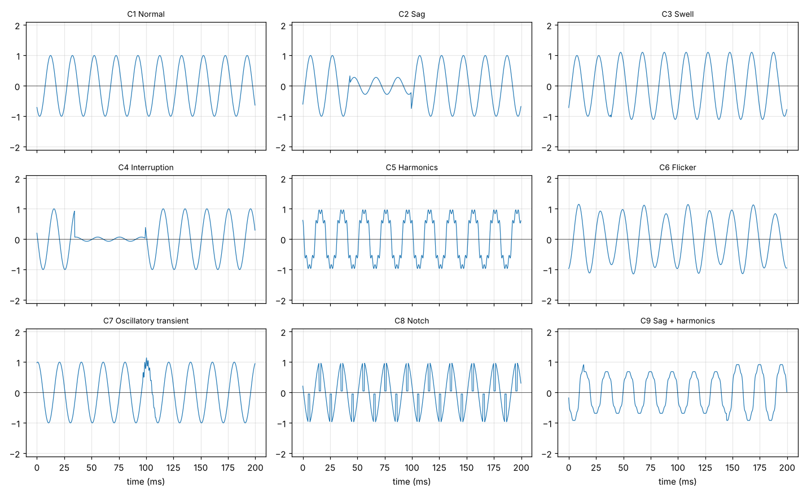
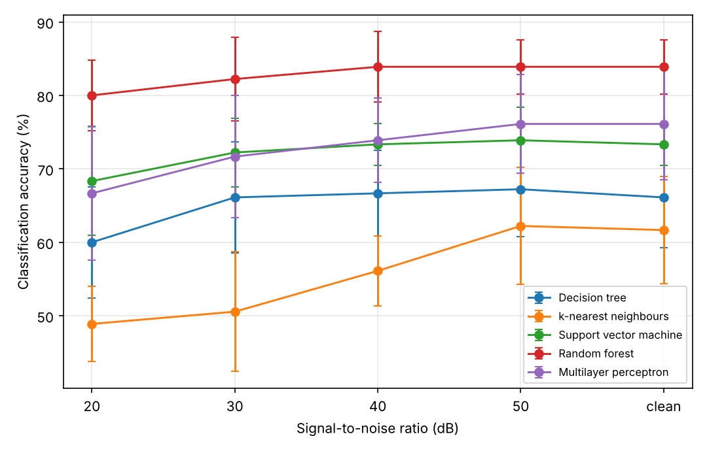
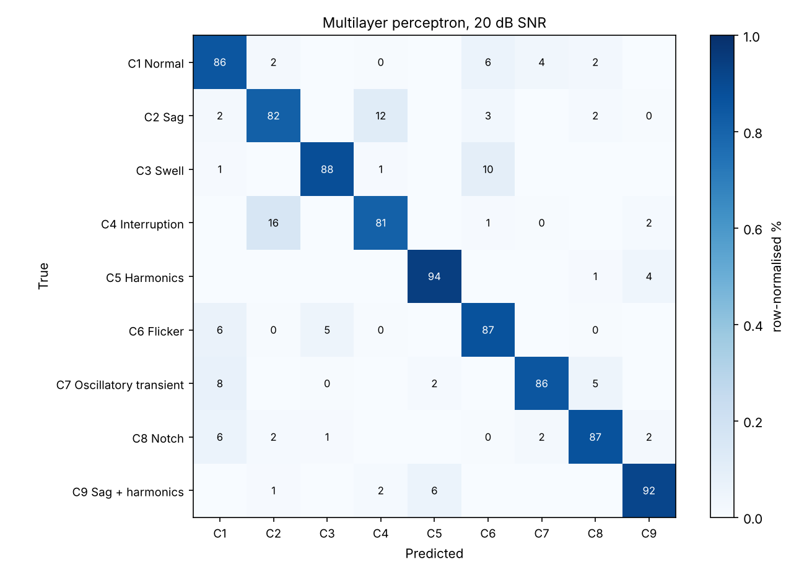
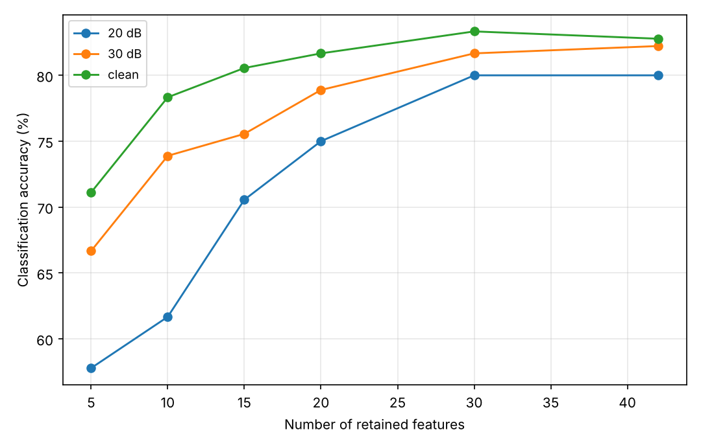
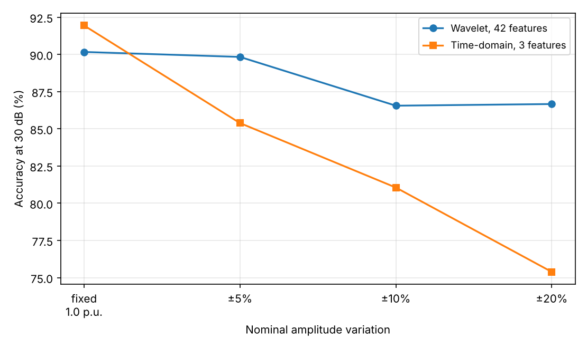

\* Corresponding author: Ismaila Hassan

Copyright © 2026 Author(s) retain the copyright of this article. This article is published under the terms of the Creative Commons Attribution Liscense 4.0.

# Classification of power quality disturbances using wavelet features and machine learning

Ismaila Hassan ^1,\ \*^, Sani Abubakar ^1^, Aliyu Muhammad Aliyu ^1^, Mahmud Suleiman ^1^ and Ruby Chinyere Beremeh ^1^

^1^ Department of Electrical Electronic Engineering, Nigerian Defence Academy, Kaduna, 800281, Nigeria.

*Journal name, year, volume(issue), page range — to be inserted on acceptance*

Publication history: Received on (date); revised on (date); accepted on (date)

Article DOI: (to be inserted)

## Abstract

Power quality disturbances such as voltage sags, swells, harmonics and transients affect the reliable operation of electrical equipment. Identifying them automatically from recorded waveforms is an important part of modern power quality monitoring. This study tested how well five machine learning classifiers can identify nine types of power quality disturbance, and how their performance changes when measurement noise is present. Nine disturbance classes were generated in Python using standard mathematical models, giving 1,800 signals. Each signal was then corrupted with noise at four levels, producing a dataset of 9,000 signals. Features were extracted using a five-level discrete wavelet transform with the db4 wavelet, giving 42 features per signal. Five classifiers were compared: a decision tree, k-nearest neighbours, a support vector machine, a random forest and a multilayer perceptron. The multilayer perceptron, random forest and support vector machine performed best, reaching about 93% accuracy on clean signals and about 86% at the highest noise level tested. Voltage sags and interruptions were the most frequently confused pair. Twenty of the 42 features were enough to maintain accuracy. The study also found that the common practice of fixing the signal amplitude at exactly 1.0 per unit makes the classification task easier than it should be, and that allowing the amplitude to vary gives a fairer comparison between feature types. All code and random seeds are provided so the results can be repeated.

Keywords: POWER QUALITY; WAVELET TRANSFORM; DISTURBANCE CLASSIFICATION; MACHINE LEARNING; NOISE ROBUSTNESS

## 1. Introduction

Power quality disturbances are short departures of the supply voltage from its normal shape. Common types include voltage sags, swells, interruptions, harmonic distortion, flicker, transients and notches. They shorten equipment life, cause protection to trip when it should not, and interfere with the power electronic converters used in drives, inverters and renewable energy systems.

Modern power quality monitors record large amounts of waveform data. Checking these recordings by hand is slow and impractical, so automatic classification is needed. The usual approach has two stages. First, a mathematical transform is applied to the recorded waveform to produce a set of numbers, called features, that describe its shape. Second, a machine learning classifier uses those features to decide which type of disturbance occurred.

The discrete wavelet transform (DWT) is widely used for the first stage because it describes a signal at several frequency scales at once. This suits power quality work, where a fast transient and a slow voltage sag must both be detected in the same recording.

Most published studies report accuracy on clean or nearly clean signals. Real measurements always contain some noise, from instrument transformers, from the analogue input circuits of the monitor, and from the electrical environment of the substation. Noise affects the high frequency parts of the wavelet decomposition most, and those are the parts that carry information about fast disturbances. It is therefore useful to know how much accuracy is lost as noise increases.

This study had three aims:

1. To measure how the accuracy of five common classifiers changes as noise increases, using the same dataset for all of them.
2. To find out which disturbance types become difficult to tell apart when noise is present.
3. To find the smallest number of features that still gives good accuracy, since fewer features means less computation in a practical device.

All signals were generated in Python, and all code and random seeds are provided so that the results can be repeated exactly.

The rest of the paper is organised as follows. Section 2 reviews related work. Section 3 describes the test signals, the feature extraction and the classification method. Section 4 presents the results. Section 5 discusses the findings, Section 6 states the limitations and Section 7 concludes.

## 2. Related work

### 2.1 Feature extraction

The **fast Fourier transform** gives the frequency content of a signal and is suitable for steady harmonic analysis. It cannot show when a disturbance started or how long it lasted, because it assumes the signal does not change with time. A two-cycle sag and an eight-cycle sag give similar results.

The **short-time Fourier transform** solves part of this by analysing the signal in short windows. However, the window length must be chosen in advance, and one length cannot suit both fast transients and low-order harmonics.

The **discrete wavelet transform** uses short basis functions at high frequency and longer ones at low frequency. Fast events are located accurately in time, while the fundamental and low harmonics are resolved in frequency. The DWT is also fast enough to run on embedded hardware, which is why it is the most common choice in this field.

The **S-transform** and the **Hilbert-Huang transform** have also been applied to this problem and are reported to tolerate noise better in some studies, at higher computational cost. They were not tested here.

### 2.2 Classifiers

Decision trees are easy to interpret but usually give lower accuracy on this problem. Support vector machines, random forests and k-nearest neighbours are the most commonly reported methods, with support vector machines often performing best on wavelet features. Neural network methods, including deep networks applied directly to the waveform, avoid the need to design features by hand but require much more training data.

This study does not propose a new transform or a new classifier. It compares established methods under controlled noise conditions and reports what was measured.

## 3. Method

### 3.1 Test signals

Nine classes of single-phase voltage waveform were generated in Python. The fundamental frequency was 50 Hz, the sampling frequency 3.2 kHz (64 samples per cycle), and each signal was 10 cycles long, giving 640 samples over 200 ms. The nominal amplitude was 1.0 per unit.

Table 1. The nine disturbance classes and the parameters varied in each.

| Label | Class | Parameters varied |
| --- | --- | --- |
| C1 | Normal | phase only |
| C2 | Sag | depth 0.1–0.9 p.u., duration 1–9 cycles |
| C3 | Swell | rise 0.1–0.8 p.u., duration 1–9 cycles |
| C4 | Interruption | depth 0.9–1.0 p.u., duration 1–9 cycles |
| C5 | Harmonics | 3rd, 5th, 7th harmonics, each 0.05–0.15 p.u. |
| C6 | Flicker | modulation 0.1–0.2 p.u. at 5–20 Hz |
| C7 | Oscillatory transient | 300–900 Hz, decay 8–40 ms, 0.5–3 cycles |
| C8 | Notch | depth 0.4–1.0 p.u., width 2–5 samples |
| C9 | Sag with harmonics | both of the above |

The standard mathematical models for these classes were used. For each signal, the disturbance size, its start time, its duration and the starting phase of the fundamental were all chosen at random from uniform distributions. Varying the starting phase is important: if every signal starts at the same phase, the classifier can use that alignment as a clue, which would give a falsely high accuracy.

200 signals were generated for each class, giving 1,800 signals in total. All nine classes were plotted and checked visually before use, as shown in Figure 1.

{width=6.3in}

### 3.2 Adding noise

Each signal was then copied four times and white Gaussian noise added at signal-to-noise ratios of 50, 40, 30 and 20 dB. The noise power was calculated from the power of each individual signal, so the stated ratio applies to every signal. Together with the original clean signal this gave five versions of each waveform, and 9,000 signals in total.

The 20 dB level is deliberately severe. It is worse than a well-installed monitor would normally see, and was included to show where each method starts to fail.

### 3.3 Feature extraction

Each signal was decomposed using a five-level discrete wavelet transform with the db4 wavelet. This gives six frequency bands: five detail bands D1 to D5 and one approximation band A5.

Table 2. Frequency bands at a 3.2 kHz sampling rate, and what each mainly contains.

| Band | Frequency range | Main content |
| --- | --- | --- |
| D1 | 800–1600 Hz | fast transients, notches, most of the noise |
| D2 | 400–800 Hz | oscillatory transients |
| D3 | 200–400 Hz | higher harmonics |
| D4 | 100–200 Hz | 3rd and 5th harmonics |
| D5 | 50–100 Hz | fundamental region |
| A5 | 0–50 Hz | envelope: sag, swell, interruption, flicker |

Seven statistical quantities were calculated from the wavelet coefficients of each band: energy, Shannon entropy, standard deviation, mean absolute value, peak magnitude, kurtosis and skewness. This gives 6 × 7 = 42 features per signal. Band energies were divided by the total signal energy so that the classifier responds to how energy is spread across the bands rather than to the overall size of the signal.

For comparison, three simple time-domain features were also calculated: the RMS value, the crest factor and the total harmonic distortion.

### 3.4 Classification and testing

Five classifiers were compared: a decision tree, k-nearest neighbours, a support vector machine with an RBF kernel, a random forest of 300 trees, and a multilayer perceptron with one hidden layer of 100 neurons. The decision tree was included as a simple reference.

Five-fold cross-validation was used. One point needs care here. Each original waveform appears five times in the dataset, once clean and four times with different noise added. These five copies are nearly identical. If the 9,000 signals were split at random, copies of the same waveform would end up in both the training set and the test set, and the classifier would be tested partly on signals it had already seen. The accuracy would then look better than it really is.

To avoid this, the folds were formed from the 1,800 original waveforms rather than the 9,000 signals, so that all five noisy copies of a waveform always stayed together in the same fold. The effect of this choice is measured in Section 4.2.

All feature scaling was carried out inside each fold, using only the training data, so that no information from the test fold could influence training. Accuracy and F1 score are reported as the mean and standard deviation across the five folds.

## 4. Results

All results come from one run over the 9,000-signal dataset using master seed 20251021. The run took 682 seconds on a single laptop.

### 4.1 Accuracy as noise increases

Table 3. Accuracy (%) for each classifier at each noise level. Values are the mean and standard deviation across the five folds.

| Classifier | Clean | 50 dB | 40 dB | 30 dB | 20 dB |
| --- | --- | --- | --- | --- | --- |
| Decision tree | 86.11 ± 1.15 | 86.17 ± 0.97 | 84.56 ± 0.85 | 79.06 ± 1.97 | 73.00 ± 1.63 |
| k-nearest neighbours | 76.11 ± 1.77 | 76.11 ± 1.37 | 74.06 ± 1.69 | 71.06 ± 1.45 | 66.22 ± 1.85 |
| Support vector machine | 92.39 ± 0.89 | 92.28 ± 0.95 | 91.28 ± 0.99 | 89.06 ± 1.27 | 86.39 ± 1.05 |
| Random forest | 93.72 ± 1.21 | 93.39 ± 1.03 | 92.56 ± 0.90 | 89.72 ± 1.45 | 86.06 ± 1.46 |
| Multilayer perceptron | 93.72 ± 0.92 | 93.67 ± 0.89 | 92.94 ± 0.72 | 90.17 ± 1.29 | 86.89 ± 0.71 |

{width=5.9in}

Three points can be drawn from Table 3.

First, accuracy falls gradually rather than suddenly. The three best classifiers lose between 6.8 and 7.7 percentage points from clean signals down to 20 dB. There is no noise level at which performance collapses. The steepest fall is between 40 dB and 30 dB.

Second, the multilayer perceptron, random forest and support vector machine gave very similar results. At 20 dB they are separated by less than one percentage point (86.89, 86.06 and 86.39), while the variation between folds is between 0.71 and 1.46. The difference between them is therefore smaller than the normal variation of the experiment, and we cannot say that any one of these three is better than the others. What can be said is that all three are clearly better than the decision tree (73.00) and k-nearest neighbours (66.22) at every noise level, and that the order of the five classifiers does not change as noise increases.

Third, k-nearest neighbours was the weakest method, not the decision tree. With 42 features, distances between points become less informative, which is a known difficulty for this method.

The multilayer perceptron gave the highest accuracy at 20 dB and is used for the remaining results.

### 4.2 Effect of how the data is split

The grouping described in Section 3.4 was tested by repeating the whole experiment with the 9,000 signals split at random instead.

Table 4. Overall accuracy (%) under the two ways of splitting the data.

| Classifier | Grouped split | Random split | Difference |
| --- | --- | --- | --- |
| Decision tree | 81.78 | 88.78 | +7.00 |
| k-nearest neighbours | 72.71 | 79.56 | +6.84 |
| Support vector machine | 90.28 | 96.16 | +5.88 |
| Random forest | 91.09 | 96.13 | +5.04 |
| Multilayer perceptron | 91.48 | 96.87 | +5.39 |

Splitting at random raised the measured accuracy by between 5.0 and 7.0 percentage points for every classifier. Under the random split, four of the five classifiers exceeded 96%. Under the correct grouped split the same classifiers reached 90 to 91% on the same data.

This shows that when a dataset has been enlarged by adding noise to the same waveforms, the way the data is split has a large effect on the measured accuracy. The grouped split is used for all other results reported here.

### 4.3 Which disturbances were confused

{width=6.1in}

Table 5. F1 score for each class at each noise level, multilayer perceptron.

| Class | Clean | 50 dB | 40 dB | 30 dB | 20 dB | Change |
| --- | --- | --- | --- | --- | --- | --- |
| C1 Normal | 0.961 | 0.961 | 0.952 | 0.900 | 0.819 | −0.142 |
| C2 Sag | 0.836 | 0.833 | 0.837 | 0.829 | 0.805 | −0.031 |
| C3 Swell | 0.980 | 0.972 | 0.949 | 0.914 | 0.908 | −0.072 |
| C4 Interruption | 0.837 | 0.831 | 0.839 | 0.848 | 0.827 | −0.010 |
| C5 Harmonics | 0.968 | 0.968 | 0.963 | 0.946 | 0.935 | −0.033 |
| C6 Flicker | 0.972 | 0.970 | 0.938 | 0.903 | 0.839 | −0.133 |
| C7 Oscillatory transient | 0.970 | 0.975 | 0.975 | 0.951 | 0.892 | −0.078 |
| C8 Notch | 0.957 | 0.962 | 0.956 | 0.901 | 0.881 | −0.076 |
| C9 Sag with harmonics | 0.955 | 0.957 | 0.954 | 0.924 | 0.915 | −0.040 |

The largest confusion is between **sag and interruption**. At 20 dB, 16.0% of interruptions were classified as sags and 11.5% of sags as interruptions. These two classes have the lowest F1 scores at every noise level, including on clean signals. The reason is that they differ only by the depth of the voltage drop, with the boundary set at 0.9 p.u. A sag of depth 0.88 and an interruption of depth 0.92 are almost the same waveform. This is a limitation of the class definitions rather than of the features, and it would affect any classifier using these definitions.

The classes that lost most accuracy as noise increased were **normal (−0.142)** and **flicker (−0.133)**, not the transient and notch classes as might be expected. The explanation is that noise does not only hide high-frequency features, it also adds them. A normal sine wave with noise added gains energy in the D1 and D2 bands, which makes it resemble a signal containing a transient or a notch. The confusion matrix shows this: at 20 dB, 6% of normal signals were classified as flicker, 4% as oscillatory transient and 2% as notch, and in the other direction 8% of transients and 6% of notches were classified as normal. At high noise levels, recognising that no disturbance is present is harder than recognising that one is.

The sag, interruption and swell classes were least affected by noise, because they are identified by a large change in the signal envelope, which appears in the A5 band where added noise contributes very little.

One further confusion was not expected: 10% of swells were classified as flicker at 20 dB. Both involve a change in signal amplitude, and over a record of only ten cycles it can be difficult to tell a sustained change from a slow periodic one.

### 4.4 Which features mattered

Feature importance was obtained from the random forest, averaged over the training folds.

Table 6. The ten most important features.

| Rank | Band | Quantity | Importance |
| --- | --- | --- | --- |
| 1 | D1 | kurtosis | 0.0527 |
| 2 | D3 | mean absolute value | 0.0479 |
| 3 | D5 | kurtosis | 0.0437 |
| 4 | D5 | entropy | 0.0436 |
| 5 | D1 | entropy | 0.0424 |
| 6 | D1 | peak magnitude | 0.0406 |
| 7 | D4 | standard deviation | 0.0363 |
| 8 | D3 | standard deviation | 0.0355 |
| 9 | D2 | standard deviation | 0.0344 |
| 10 | D1 | standard deviation | 0.0332 |

No single feature dominates. The most important one accounts for 5.3% of the total, and the top ten together for about 40%. Four of the top ten come from D1, the band that carries fast transients, and the quantities chosen there are kurtosis, entropy and peak magnitude, which are the ones that respond to sudden changes.

The classifier was then retrained using only the highest-ranked features.

Table 7. Accuracy at 30 dB using different numbers of features.

| Features used | Accuracy (%) |
| --- | --- |
| 5 | 69.72 |
| 10 | 83.78 |
| 15 | 88.33 |
| 20 | 90.72 |
| 30 | 92.11 |
| 42 (all) | 90.44 |

{width=5.9in}

Twenty features gave 90.72%, which is as good as the full set of 42 (90.44%). A paired t-test across the folds gave p = 0.561, meaning no measurable difference. Using fewer than half the features therefore costs nothing, which matters if the method is to run on simple hardware.

Using 30 features gave 92.11%, which is better than using all 42 (p = 0.005). The twelve least important features slightly reduce accuracy rather than helping. This is normal behaviour when features that carry little information are added, and it suggests that calculating all seven quantities on all six bands is not necessary.

These tests used only five folds, so small differences should not be read too closely. The results for 20 and 30 features are supported by differences that are large compared with the variation between folds.

### 4.5 Effect of the mother wavelet and of simple features

Two checks were carried out at 30 dB using the multilayer perceptron.

Table 8. Accuracy under different feature choices, at 30 dB.

| Features used | Accuracy (%) |
| --- | --- |
| db4, 5 levels, 42 wavelet features | 90.17 ± 1.29 |
| db10, 5 levels | 90.67 ± 1.11 |
| Three time-domain features only | 91.94 ± 0.75 |

Changing the wavelet from db4 to db10 altered the accuracy by only 0.50 points, which is within the fold-to-fold variation. The choice of wavelet therefore does not affect the conclusions.

The second result was unexpected. The three simple time-domain features (RMS, crest factor and THD) gave 91.94%, slightly higher than the 42 wavelet features. This needed explaining before it could be accepted, and Section 4.6 gives the explanation.

### 4.6 Effect of fixing the signal amplitude

None of the three time-domain features is strong on its own. At 30 dB, RMS alone gives 45.67%, crest factor 26.22% and THD 29.78%. Together they give 93.06%. The reason can be seen in the RMS values of the clean signals.

Table 9. RMS of the clean signals, by class.

| Class | Mean RMS | Standard deviation | Range |
| --- | --- | --- | --- |
| C1 Normal | 0.707 | 0.000 | 0.707–0.707 |
| C2 Sag | 0.568 | 0.094 | 0.269–0.684 |
| C3 Swell | 0.874 | 0.110 | 0.719–1.200 |
| C4 Interruption | 0.488 | 0.117 | 0.228–0.670 |
| C5 Harmonics | 0.707 | 0.000 | 0.707–0.707 |
| C6 Flicker | 0.718 | 0.007 | 0.709–0.742 |
| C7 Oscillatory transient | 0.712 | 0.004 | 0.707–0.727 |
| C8 Notch | 0.672 | 0.027 | 0.592–0.707 |
| C9 Sag with harmonics | 0.553 | 0.101 | 0.268–0.696 |

The normal and harmonics classes have an RMS of exactly 0.707 with no variation at all, and the flicker, transient and notch classes occupy narrow bands just above and below. This is not a property of power quality disturbances. It follows from two modelling choices: the nominal amplitude is fixed at exactly 1.0 p.u., and the harmonic amplitudes are scaled so that the total signal power is exactly 1 p.u. Together these make the RMS of a signal an almost direct indication of its class. A real measurement would not behave this way, because the nominal voltage varies with transformer tap position, with loading and with where the measurement is taken.

To test this, the comparison was repeated with the nominal amplitude of each signal chosen at random over increasingly wide ranges, with everything else unchanged.

Table 10. Wavelet features compared with time-domain features as the amplitude is allowed to vary (multilayer perceptron, 30 dB).

| Nominal amplitude | Wavelet, 42 features (%) | Time-domain, 3 features (%) | Difference |
| --- | --- | --- | --- |
| Fixed at 1.0 p.u. | 90.17 ± 1.29 | 91.94 ± 0.75 | −1.78 |
| ±5% | 89.83 ± 2.31 | 85.39 ± 1.41 | +4.44 |
| ±10% | 86.56 ± 2.05 | 81.06 ± 2.68 | +5.50 |
| ±20% | 86.67 ± 1.64 | 75.39 ± 2.07 | +11.28 |

{width=5.9in}

The result is clear. The wavelet features are largely unaffected by amplitude variation, losing 3.50 points across the whole range. The time-domain features lose 16.55 points. A variation of only ±5%, which is smaller than the normal permitted voltage tolerance, is enough to reverse the comparison. At ±20% the wavelet features are ahead by 11.28 points.

This explains the result in Section 4.5. The advantage of the wavelet features is that they describe how energy is distributed across frequency, independently of how large the signal is. Fixing the amplitude removes that advantage, because the overall size of the signal then becomes a reliable clue by itself.

Two practical points follow. Accuracy measured on a dataset with fixed amplitude is higher than it would be on more realistic signals, and part of what the classifier learns is a property of the generator rather than of the disturbance. Randomising the nominal amplitude when generating test signals avoids this, and costs one line of code. The generator released with this paper supports it.

## 5. Discussion

The accuracies obtained here, around 93% on clean signals and 86% at 20 dB, are lower than the figures of 98% and above that are often reported for this problem. Three features of the method explain this.

The folds were formed from the original waveforms rather than from the noisy copies, which avoids testing a classifier on signals it has already seen. Section 4.2 shows that this alone accounts for 5 to 7 percentage points. The starting phase of every signal was randomised, removing a clue that would otherwise be available. And nine classes were used, including one combination class and the sag and interruption pair, which cannot be separated reliably because they differ only by a threshold.

The figures reported here should therefore be read as results obtained under a deliberately strict test, not as a shortfall of the method.

## 6. Limitations

**The signals are generated, not measured.** This is the most important limitation. Real disturbances occur against a background of existing harmonic distortion, often overlap one another, and are altered by the instrument transformer and the input circuits of the monitor. A classifier that performs well on generated signals may perform less well on real recordings. This study compares methods under controlled conditions; it does not establish what accuracy would be obtained in the field.

**The noise is white Gaussian noise.** Substation noise is not white. It includes narrow-band interference and switching impulses, which would affect the wavelet bands differently.

**The frequency is fixed at 50 Hz.** Real systems drift, and on a weak network the drift can be significant. Frequency deviation would move energy across the wavelet band boundaries, which would be expected to reduce accuracy. This was not tested.

**Only single-phase signals were used.** Three-phase information such as unbalance and negative-sequence content is useful for diagnosis and is not available here.

**Amplitude variation is a correction, not a model of reality.** The uniform ranges used in Section 4.6 are a way of testing the effect of the fixed-amplitude assumption, not a claim about how supply voltage is actually distributed. The main results in Sections 4.1 to 4.5 keep the fixed amplitude so that they remain comparable with other published work, which means they carry the effect described in Section 4.6.

**No comparison with other transforms.** The S-transform and Hilbert-Huang transform were not tested.

## 7. Conclusion

Five machine learning classifiers were compared for the identification of nine power quality disturbance classes, using features from a five-level db4 wavelet decomposition, across four noise levels and a clean reference.

The main findings are:

1. Accuracy falls gradually as noise increases. The best three classifiers fall from about 93.7% on clean signals to between 86.1% and 86.9% at 20 dB, and their order does not change. The differences between these three are smaller than the variation between folds, so none can be said to be better than the others.
2. How the dataset is split matters. Splitting the noisy copies at random raised the measured accuracy by 5.0 to 7.0 percentage points compared with keeping all copies of a waveform in the same fold.
3. Sag and interruption are the hardest pair to separate, giving 16.0% and 11.5% misclassification at 20 dB, because they differ only by a threshold on the depth of the voltage drop.
4. The normal class loses the most accuracy as noise increases, because added noise creates high-frequency content that resembles a transient or a notch. Detecting that no disturbance is present is harder at high noise than detecting that one is.
5. Twenty of the 42 features give the same accuracy as all 42, and 30 features give slightly better accuracy than 42.
6. Fixing the nominal amplitude at 1.0 p.u. makes the test easier than it should be. Under this assumption three simple time-domain features slightly outperform the 42 wavelet features; once the amplitude is allowed to vary by ±20%, the wavelet features lead by 11.28 points.

The most useful extension of this work would be to test the method on real recorded disturbances, either from a public dataset or from laboratory measurements, and to report how much accuracy is lost in moving from generated to measured signals. The code is written so that a measured dataset can be used in place of the generated one without modification.

## Compliance with ethical standards

### Acknowledgment

The authors thank the Department of Electrical Electronic Engineering, Nigerian Defence Academy, Kaduna, for supporting this work.

### Disclosure of conflict of interest

The authors declare no conflict of interest.

### Data availability

All code used to generate the signals, extract the features and carry out the testing is available, together with the figures and result files, at https://drive.google.com/file/d/1AaD-IVGdtOotkEkZsKydU4-z5Bprq0B6/view. The archive includes the random seed (20251021) that reproduces every figure reported here. The software requires only Python, NumPy, PyWavelets, scikit-learn, SciPy and Matplotlib.

## References

*To be confirmed before submission. These sources were located by literature search but could not be opened on the machine used to prepare this draft. Details marked [confirm] came from indexes and citing papers rather than from the papers themselves.*

[1] *IEEE Recommended Practice for Monitoring Electric Power Quality*, IEEE Std 1159-2019, Institute of Electrical and Electronics Engineers, 2019.

[2] *[To select — the source of the signal models used in Section 3.1.]*

[3] Mishra, "Power quality disturbance detection and classification using signal processing and soft computing techniques: A comprehensive review," *International Transactions on Electrical Energy Systems*, 2019, doi: 10.1002/2050-7038.12008. *[confirm]*

[4] J. Wang, Z. Xu and Y. Che, "Power quality disturbance classification based on DWT and multilayer perceptron extreme learning machine," *Applied Sciences*, vol. 9, no. 11, art. 2315, 2019. *[confirm]*

[5] Khokhar et al., "A new optimal feature selection algorithm for classification of power quality disturbances using discrete wavelet transform and probabilistic neural network," *Measurement*, 2017. *[confirm]*

[6] S. Kapoor and A. Narayanan, "Leakage and the reproducibility crisis in machine-learning-based science," *Patterns*, vol. 4, no. 9, art. 100804, 2023.

[7] C. R. Harris et al., "Array programming with NumPy," *Nature*, vol. 585, pp. 357–362, 2020.

[8] F. Pedregosa et al., "Scikit-learn: Machine learning in Python," *Journal of Machine Learning Research*, vol. 12, pp. 2825–2830, 2011.

[9] G. R. Lee, R. Gommers, F. Waselewski, K. Wohlfahrt and A. O'Leary, "PyWavelets: A Python package for wavelet analysis," *Journal of Open Source Software*, vol. 4, no. 36, art. 1237, 2019. *[confirm]*

Further sources are still needed for Section 2, particularly on the S-transform, the Hilbert-Huang transform, and classifier comparisons whose accuracies can be compared with those reported here.

