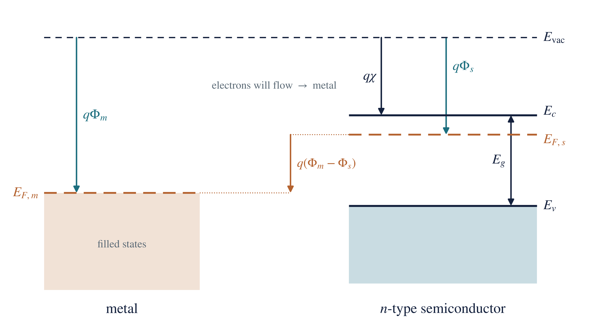
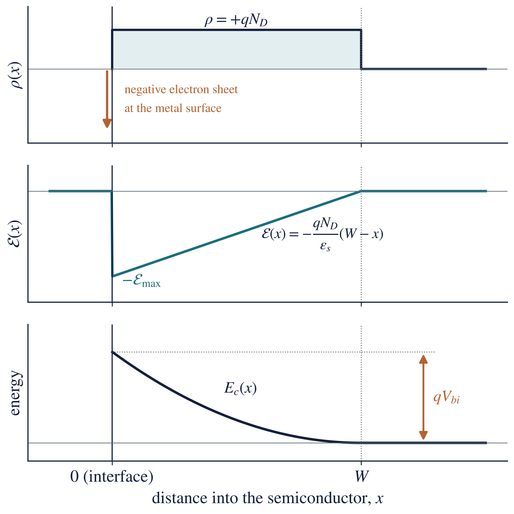
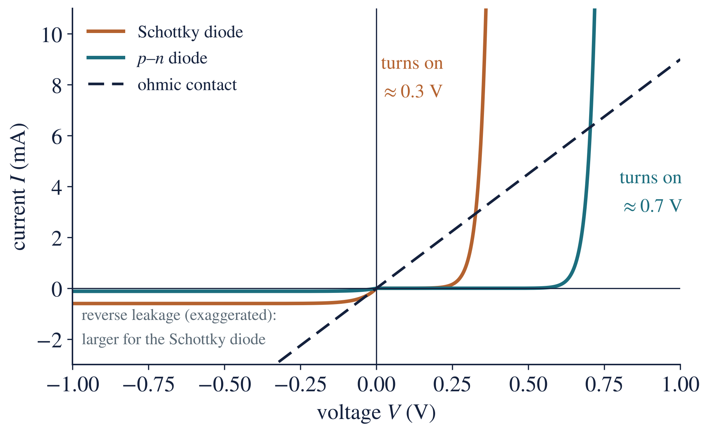

**Subtopics:** (1) Schottky barrier diode physics versus ohmic contact mechanisms; (2) energy band diagrams under equilibrium and applied bias.

**Learning objectives.** After this topic you should be able to:

1. Define work function, electron affinity and Fermi level, and relate them for a doped semiconductor.
2. Draw the energy band diagram of a metal and an n-type semiconductor before and after contact.
3. Explain how a Schottky barrier forms, and calculate the barrier height, built-in potential and depletion width.
4. Draw and explain the band diagrams under forward and reverse bias, and use the thermionic-emission equation.
5. Explain the three ways of making an ohmic contact, and why heavy doping works.
6. Compare Schottky and ohmic contacts, and answer examination question 49.

**Units.** All quantities are in SI units. Energies are quoted in electron-volts (eV), which SI accepts for use alongside its units ($1\ \mathrm{eV} = 1.6\times10^{-19}\ \mathrm{J}$). A work function $\Phi$ is a potential in volts; $q\Phi$ is the corresponding energy, and its value in eV equals the value of $\Phi$ in volts.

# 1. Introduction

Every semiconductor device has to be connected to the outside world with metal. Where a metal touches a semiconductor, a **metal–semiconductor interface** (or **contact**) is formed. When the two materials touch, electrons move from one to the other until a single Fermi level runs through both. This charge transfer can leave an energy barrier at the interface, and that barrier decides how current flows. There are two kinds of contact:

- A **Schottky contact** has a barrier to majority carriers, so it is **rectifying**: current flows easily in one direction (forward bias) and very little in the other (reverse bias). A diode made this way is a **Schottky barrier diode (SBD)**. The rectifying metal–semiconductor contact was explained by Walter Schottky and Nevill Mott in 1938–39.
- An **ohmic contact** has no barrier that limits the current, so it conducts equally in both directions with a linear current–voltage (I–V) graph. Every transistor terminal, solar-cell finger and integrated-circuit connection needs one.

A practical Schottky diode contains both: a rectifying contact on top and an ohmic contact underneath (Figure 1).

{width=78%}

# 2. Key terms and definitions

**Metal.** A material with a very large density of free electrons ($10^{28}$–$10^{29}\ \mathrm{m^{-3}}$; copper has $8.5\times10^{28}\ \mathrm{m^{-3}}$), so it conducts very well. Its electron states are filled up to the Fermi level, with empty states immediately above. Examples: aluminium, gold, platinum, titanium, tungsten.

**Semiconductor.** A material whose conductivity lies between that of a metal and an insulator and can be controlled by doping, temperature, light and electric field. Examples: silicon (Si), germanium (Ge), gallium arsenide (GaAs).

**Doping; n-type and p-type.** Adding a small, controlled amount of impurity. Donor atoms (concentration $N_D$, e.g. phosphorus in Si) give free electrons and make the material **n-type**; acceptor atoms (concentration $N_A$, e.g. boron) create holes and make it **p-type**. The carrier in the majority (electrons in n-type, holes in p-type) is the **majority carrier**.

**Band edges and band gap.** $E_c$ is the bottom of the conduction band (the lowest energy of a free electron); $E_v$ is the top of the valence band. No electron states exist between them. The band gap is

$$E_g = E_c - E_v$$

where $E_g$ is the band-gap energy (1.12 eV for Si at 300 K), $E_c$ the conduction-band edge and $E_v$ the valence-band edge.

**Fermi level ($E_F$).** The energy at which a state has a 50 % probability of being occupied by an electron. In n-type material it lies close to $E_c$, in p-type close to $E_v$. **At thermal equilibrium the Fermi level is flat: it has the same value everywhere in materials that are in contact.** For n-type silicon,

$$E_c - E_F = kT\ln\left(\frac{N_c}{N_D}\right)$$

where $kT = 0.0259\ \mathrm{eV}$ at 300 K, $N_c = 2.8\times10^{25}\ \mathrm{m^{-3}}$ is the effective density of states in the conduction band of Si, and $N_D$ is the donor concentration in $\mathrm{m^{-3}}$.

**Vacuum level ($E_{\mathrm{vac}}$).** The energy of an electron at rest just outside the material. It is the common reference from which the other energies below are measured.

**Work function ($\Phi$).** The minimum energy needed to take an electron from the Fermi level to the vacuum level:

$$q\Phi_m = E_{\mathrm{vac}} - E_{F,m}, \qquad q\Phi_s = E_{\mathrm{vac}} - E_{F,s}$$

where $\Phi_m$ and $\Phi_s$ are the work functions of the metal and of the semiconductor, $E_{F,m}$ and $E_{F,s}$ their Fermi levels, and $q = 1.6\times10^{-19}\ \mathrm{C}$ the electronic charge. A metal with a large work function holds its electrons tightly.

**Electron affinity ($\chi$).** The energy from the bottom of the conduction band to the vacuum level:

$$q\chi = E_{\mathrm{vac}} - E_c$$

Unlike $\Phi_s$, the electron affinity does not depend on doping; it is a fixed property of the material (Si 4.05 eV, GaAs 4.07 eV, Ge 4.0 eV). The two are related by

$$q\Phi_s = q\chi + \left(E_c - E_F\right)$$

so the semiconductor work function **does** change with doping, because doping moves $E_F$.

{width=62%}

**Table 1. Work functions of common contact metals and electron affinities of semiconductors.**

| Metal | Al | Ti | Cr | W | Au | Ni | Pt |
|---|---|---|---|---|---|---|---|
| $\Phi_m$ (eV) | 4.28 | 4.33 | 4.5 | 4.55 | 5.10 | 5.15 | 5.65 |

| Semiconductor | Si | Ge | GaAs |
|---|---|---|---|
| $\chi$ (eV) | 4.05 | 4.0 | 4.07 |
| $E_g$ (eV) | 1.12 | 0.66 | 1.42 |

**Depletion region.** A layer next to the interface emptied of free carriers, leaving only the fixed, charged dopant ions (positive donor ions in n-type). **Accumulation layer:** the opposite, a thin layer with extra majority carriers.

**Built-in potential ($V_{bi}$).** The voltage across the depletion region at equilibrium.

**Thermionic emission.** Carriers crossing **over** a barrier using their thermal energy. **Tunnelling (field emission):** carriers passing **through** a barrier thin enough (a few nanometres), a quantum-mechanical effect.

# 3. Energy band diagram before contact

Before the materials touch, each has its own Fermi level. Lining them up against the common vacuum level (Figure 3) shows which way electrons will move on contact. For a metal on **n-type** silicon with $\Phi_m > \Phi_s$, the semiconductor's Fermi level lies higher than the metal's by $q(\Phi_m - \Phi_s)$. Electrons always move from the higher Fermi level to the lower one, so on contact they will flow **from the semiconductor into the metal**.

{width=88%}

**Which contact forms depends on the two work functions (ideal case):**

| Semiconductor | $\Phi_m > \Phi_s$ | $\Phi_m < \Phi_s$ |
|---|---|---|
| n-type | Schottky (rectifying): depletion, bands bend up | Ohmic: accumulation, bands bend down |
| p-type | Ohmic: hole accumulation | Schottky (rectifying): bands bend down, barrier to holes |

# 4. How a Schottky barrier forms

Consider an ideal metal on n-type silicon with $\Phi_m > \Phi_s$, and no interface states (the **Schottky–Mott** model). When contact is made:

1. **Electrons flow from the semiconductor into the metal**, because the semiconductor's Fermi level is higher.
2. **Positive donor ions are left behind.** Near the interface the semiconductor loses its free electrons, uncovering the fixed ionised donors $N_D^+$.
3. **A depletion region of width $W$ forms**, holding positive charge; an equal negative charge sits as a thin sheet of extra electrons on the metal surface.
4. **An electric field appears** between the positive ions and the negative sheet, pointing from the semiconductor towards the metal.
5. **The bands bend upward** towards the interface, because the field raises the electron energy near the metal.
6. **The flow stops when the Fermi levels line up.** At equilibrium there is a single, flat Fermi level: $E_{F,m} = E_{F,s}$. Electrons still cross in both directions, but the two flows are equal, so the net current is zero.

{width=88%}

## 4.1 Barrier height and built-in potential

There are now two barriers, depending on which side the electron starts from (Figure 4).

**Barrier height (seen from the metal).** Because the vacuum level is continuous at the interface, the conduction-band edge at the interface sits at $q\chi$ below the vacuum level, while the metal Fermi level sits at $q\Phi_m$ below it:

$$q\Phi_{Bn} = q\left(\Phi_m - \chi\right)$$

where $\Phi_{Bn}$ is the Schottky barrier height for electrons (n-type), $\Phi_m$ the metal work function and $\chi$ the electron affinity. This is the **Schottky–Mott rule**. The barrier height is set by the interface and **does not change with applied bias**.

**Built-in potential (seen from the semiconductor).** The total band bending equals the original difference in Fermi levels:

$$qV_{bi} = q\left(\Phi_m - \Phi_s\right) = q\Phi_{Bn} - \left(E_c - E_F\right)$$

**p-type semiconductor.** A rectifying contact needs $\Phi_m < \Phi_s$, and the barrier is for holes:

$$q\Phi_{Bp} = E_g - q\left(\Phi_m - \chi\right)$$

so that, for the same metal, $q\Phi_{Bn} + q\Phi_{Bp} = E_g$.

## 4.2 The depletion region

With the depletion approximation (no free carriers inside $0 < x < W$, uniform doping), the charge density is $\rho = qN_D$ in the depletion region. Integrating Poisson's equation once gives a field that is largest at the interface and falls linearly to zero at $x = W$; integrating again gives the parabolic band bending (Figure 5). The results are

$$W = \sqrt{\frac{2\varepsilon_s\left(V_{bi} - V\right)}{qN_D}}, \qquad \mathcal{E}_{\max} = \frac{qN_D W}{\varepsilon_s}$$

where $W$ is the depletion width (m), $\varepsilon_s = 11.7\varepsilon_0 = 1.04\times10^{-10}\ \mathrm{F\,m^{-1}}$ the permittivity of silicon, $V$ the applied voltage (positive for forward bias), $N_D$ the donor concentration ($\mathrm{m^{-3}}$) and $\mathcal{E}_{\max}$ the peak electric field at the interface ($\mathrm{V\,m^{-1}}$). The depletion region acts like a parallel-plate capacitor of capacitance per unit area $C = \varepsilon_s/W$, which is the basis of C–V measurement (Week 12).

Two consequences matter later: $W \propto (V_{bi} - V)^{1/2}$, so reverse bias widens the region; and $W \propto 1/\sqrt{N_D}$, so heavy doping makes it very thin.

{width=70%}

## 4.3 Real interfaces: Fermi-level pinning and image-force lowering

**Fermi-level pinning.** Measured barrier heights depend much less on the metal than the Schottky–Mott rule predicts (Figure 6). The reason is **interface states**: dangling bonds and defects at the surface create electron states in the band gap. They hold, or "pin", the Fermi level near a fixed energy at the surface, whatever metal is used. On n-Si most barriers lie between 0.5 and 0.9 eV; on n-GaAs almost every metal gives about 0.8 eV. **In calculations, use a measured barrier height when one is given.**

{width=70%}

**Image-force lowering.** An electron near the metal is attracted by the positive "image" charge it induces in the metal. This rounds off the top of the barrier and lowers it slightly by

$$\Delta\Phi = \sqrt{\frac{q\,\mathcal{E}_{\max}}{4\pi\varepsilon_s}}$$

For the gold contact of Example 2 below ($\mathcal{E}_{\max} = 5.1\times10^{6}\ \mathrm{V\,m^{-1}}$), $\Delta\Phi \approx 0.025\ \mathrm{V}$: small, but it grows with reverse bias and is one reason the reverse current of a Schottky diode does not fully saturate.

# 5. Energy band diagrams under applied bias

The applied voltage is defined as $V = V_m - V_s$, the potential of the metal terminal minus that of the semiconductor terminal: **forward bias** means $V > 0$ (metal positive, for n-type) and **reverse bias** means $V < 0$, written $V = -V_R$. When a voltage is applied, the two sides are no longer in equilibrium, so there is no single flat Fermi level: the semiconductor's Fermi level moves by $qV$ relative to the metal's. **The key rule: the barrier seen from the metal, $q\Phi_{Bn}$, stays fixed; the applied voltage appears across the depletion region and changes only the barrier seen from the semiconductor** (Figure 7).

{width=100%}

| | Equilibrium, $V = 0$ | Forward bias, $V > 0$ (metal positive) | Reverse bias, $V = -V_R$ (metal negative) |
|---|---|---|---|
| Fermi levels | one flat $E_F$ | semiconductor $E_F$ raised by $qV$ | semiconductor $E_F$ lowered by $qV_R$ |
| Band bending | $qV_{bi}$ | $q(V_{bi} - V)$, smaller | $q(V_{bi} + V_R)$, larger |
| Depletion width | $W_0$ | narrower | wider |
| Electrons semiconductor → metal | balance the reverse flow | increase by $\exp(qV/kT)$ | almost stopped |
| Electrons metal → semiconductor | small, over $q\Phi_{Bn}$ | unchanged | unchanged: this is the saturation current |
| Net current | zero | large, rises exponentially | small, about $-I_s$ |

In the ideal model the reverse current approaches $-I_s$ once the reverse voltage is a few times $kT/q$ (about 0.1 V). At large reverse voltage the field becomes strong enough for **breakdown**. Schottky diodes break down at lower voltages than comparable p–n diodes.

# 6. Current transport: thermionic emission

In a Schottky diode the current is carried by **majority carriers** (electrons in n-type) crossing **over** the barrier. Only electrons with enough thermal energy get over, so the current depends exponentially on the barrier height and on temperature:

$$J = J_s\left[\exp\left(\frac{qV}{\eta kT}\right) - 1\right], \qquad J_s = A^{**}\,T^{2}\exp\left(-\frac{q\Phi_{Bn}}{kT}\right)$$

where

- $J$ is the current density ($\mathrm{A\,m^{-2}}$); the current is $I = JA$ for a contact of area $A$, so $I = I_s\left[\exp\left(qV/\eta kT\right) - 1\right]$ with $I_s = J_sA$;
- $J_s$ is the saturation current density ($\mathrm{A\,m^{-2}}$);
- $V$ is the applied voltage, positive for forward bias (V);
- $\eta$ is the ideality factor: 1 for ideal thermionic emission, 1.0–1.1 for a good diode (some books write it as $n$);
- $k = 1.381\times10^{-23}\ \mathrm{J\,K^{-1}}$ is the Boltzmann constant ($kT/q = 0.0259\ \mathrm{V}$ at 300 K) and $T$ the absolute temperature (K);
- $A^{**}$ is the effective Richardson constant, about $1.1\times10^{6}\ \mathrm{A\,m^{-2}\,K^{-2}}$ for n-type Si.

The I–V curve has the same shape as a p–n diode's, but $J_s$ is typically $10^{3}$–$10^{8}$ times larger, so the Schottky diode turns on at a lower voltage (about 0.2–0.4 V on Si, against 0.6–0.7 V) and has a larger reverse leakage current (Figure 8). Other transport routes add to thermionic emission in real diodes: tunnelling through the top of the barrier at heavy doping (thermionic-field emission), recombination in the depletion region, and the voltage drop across the series resistance.

{width=68%}

## 6.1 Schottky diode versus p–n diode

| | Schottky diode | p–n junction diode |
|---|---|---|
| Current carried by | majority carriers only | minority carriers injected and diffusing |
| Transport mechanism | thermionic emission over the barrier | diffusion |
| Stored minority charge | practically none | yes, $Q \approx I\tau$ |
| Switching speed | very fast, no reverse-recovery delay | slower (recovery time about $\tau$) |
| Turn-on voltage (Si) | 0.2–0.4 V | 0.6–0.7 V |
| Reverse leakage | higher | lower |
| Breakdown voltage | lower | higher |

**Applications of Schottky contacts:** fast, low-loss rectifiers in switching power supplies; RF and microwave detectors and mixers; clamping diodes that stop transistors saturating (Schottky TTL); gates of MESFETs and HEMTs; photodetectors and some solar-cell structures.

# 7. Ohmic contacts

An **ohmic contact** lets current flow equally easily in both directions, with a linear I–V characteristic and a resistance negligible compared with the device:

$$V = IR_c, \qquad R_c = \frac{\rho_c}{A}$$

where $V$ is the voltage across the contact (V), $I$ the current (A), $R_c$ the contact resistance (Ω), $A$ the contact area ($\mathrm{m^2}$), and $\rho_c$ the **specific contact resistance** ($\Omega\,\mathrm{m^2}$), which allows contacts of different sizes to be compared. Good contacts reach $\rho_c \approx 10^{-10}$–$10^{-12}\ \Omega\,\mathrm{m^2}$.

**An ohmic contact is not necessarily a contact with no barrier.** It may have a barrier that is so low, or so thin, that it does not restrict the current. There are three ways to make one (Figure 9).

**Method 1: a low work-function metal (accumulation).** For n-type, choose $\Phi_m < \Phi_s$ (for p-type, $\Phi_m > \Phi_s$). On contact, electrons flow from the metal **into** the semiconductor and pile up in an accumulation layer; the bands bend **downward** and there is no barrier to electrons in either direction. In practice, Fermi-level pinning makes suitable metals rare for Si and GaAs, so this method alone is unreliable.

**Method 2: heavy doping, so that electrons tunnel (the practical method).** Dope the semiconductor very heavily just under the contact ($n^{+}$ or $p^{+}$, above about $10^{25}\ \mathrm{m^{-3}}$). The barrier height does not change, but since

$$W \propto \frac{1}{\sqrt{N_D}}$$

the barrier becomes only a few nanometres thick. Electrons then **tunnel** straight through it in both directions (field emission). The specific contact resistance falls steeply, roughly exponentially, as the doping rises.

**Method 3: contact engineering.** Clean the surface (remove the native oxide), deposit the metal and anneal it so that it reacts with the semiconductor to form a stable compound with a low barrier: a **silicide** ($\mathrm{TiSi_2}$, $\mathrm{CoSi_2}$, NiSi) on silicon, or an alloyed Au–Ge–Ni contact on n-GaAs. This is combined with Method 2 in practice.

{width=100%}

| | Thermionic emission | Tunnelling (field emission) |
|---|---|---|
| How the electron crosses | over the top of the barrier | through the barrier |
| Needs | enough thermal energy | a thin barrier (a few nm) |
| Doping under the contact | light to moderate ($\le 10^{23}\ \mathrm{m^{-3}}$) | heavy ($\ge 10^{25}\ \mathrm{m^{-3}}$) |
| Temperature dependence | strong, $\propto T^{2}\exp\left(-q\Phi_{Bn}/kT\right)$ | weak |
| Gives | Schottky (rectifying) contact | ohmic contact |

**Applications of ohmic contacts:** source, drain and gate connections of MOSFETs; emitter, base and collector contacts of BJTs; front and back contacts of solar cells (a poor contact adds series resistance and lowers the fill factor and output power); contacts to LEDs and lasers; every connection in an integrated circuit and every test structure.

**Stability of contacts.** Contacts must survive hot processing and years of use. Problems include aluminium "spiking" into shallow junctions (prevented with 1 % Si in the Al or a TiN barrier), electromigration of the metal at high current density, and reactions or native oxide at the interface that change $\Phi_{Bn}$ and $\rho_c$.

# 8. Schottky contact versus ohmic contact

**Why both contacts are needed.** A practical device usually contains both. A Schottky diode has its rectifying contact on one side and an ohmic contact on the other (Figure 1): the Schottky contact gives the rectification, while the ohmic contact lets the current enter or leave without an extra barrier or voltage drop. In a solar cell every contact must be ohmic; an accidental rectifying contact adds resistance, lowers the fill factor and reduces the output power.

| Feature | Schottky contact | Ohmic contact |
|---|---|---|
| Electrical behaviour | rectifying | non-rectifying |
| I–V curve | exponential, asymmetric | straight line through the origin |
| Work-function condition (n-type) | $\Phi_m > \Phi_s$ | $\Phi_m < \Phi_s$, or any metal on $n^{+}$ |
| Doping under the contact | moderate ($10^{21}$–$10^{23}\ \mathrm{m^{-3}}$) | heavy ($> 10^{25}\ \mathrm{m^{-3}}$) |
| Band bending (n-type) | upward: depletion layer | downward (accumulation) or a very thin barrier |
| Barrier to majority carriers | yes: $q\Phi_{Bn}$ and $qV_{bi}$ | none, or thin enough to tunnel through |
| Transport | thermionic emission | free flow or tunnelling |
| Resistance | depends on bias and polarity | small and constant |
| Advantages | fast switching; low forward voltage | low resistance; efficient current collection |
| Limitations | higher leakage; lower breakdown voltage | needs heavy doping and careful processing |
| Used for | rectifiers, detectors, clamps, MESFET gates | connecting every device to the circuit |

# 9. Worked examples

All examples are for silicon at 300 K: $\chi = 4.05\ \mathrm{eV}$, $E_g = 1.12\ \mathrm{eV}$, $kT = 0.02585\ \mathrm{eV}$, $N_c = 2.8\times10^{25}\ \mathrm{m^{-3}}$, $\varepsilon_s = 1.04\times10^{-10}\ \mathrm{F\,m^{-1}}$, $q = 1.6\times10^{-19}\ \mathrm{C}$.

## Example 1: work function of doped silicon

**Question.** Find the work function of n-type silicon with $N_D = 1\times10^{22}\ \mathrm{m^{-3}}$.

**Given:** $N_D = 1\times10^{22}\ \mathrm{m^{-3}}$, $N_c = 2.8\times10^{25}\ \mathrm{m^{-3}}$, $\chi = 4.05\ \mathrm{eV}$. **Find:** $\Phi_s$.

**Formula:** $E_c - E_F = kT\ln\left(N_c/N_D\right)$, then $q\Phi_s = q\chi + \left(E_c - E_F\right)$.

**Solution.**

$$E_c - E_F = (0.02585)\ln\left(\frac{2.8\times10^{25}}{1\times10^{22}}\right) = (0.02585)(7.94) = 0.205\ \mathrm{eV}$$

$$\Phi_s = 4.05 + 0.205 = 4.26\ \mathrm{eV}$$

**Answer:** $\Phi_s = 4.26\ \mathrm{eV}$. **What this means:** any metal with $\Phi_m > 4.26\ \mathrm{eV}$ (gold, nickel, platinum) tends to form a Schottky barrier on this silicon.

## Example 2: an ideal gold contact

**Question.** Gold ($\Phi_m = 5.10\ \mathrm{eV}$) is deposited on the silicon of Example 1. Using the Schottky–Mott model, find the barrier height, built-in potential, depletion width and peak field at zero bias.

**Given:** $\Phi_m = 5.10\ \mathrm{eV}$, $\chi = 4.05\ \mathrm{eV}$, $\Phi_s = 4.26\ \mathrm{eV}$, $N_D = 1\times10^{22}\ \mathrm{m^{-3}}$, $V = 0$. **Find:** $\Phi_{Bn}$, $V_{bi}$, $W$, $\mathcal{E}_{\max}$.

**Formulas:** $q\Phi_{Bn} = q(\Phi_m - \chi)$; $qV_{bi} = q(\Phi_m - \Phi_s)$; $W = \sqrt{2\varepsilon_s V_{bi}/qN_D}$; $\mathcal{E}_{\max} = qN_DW/\varepsilon_s$.

**Solution.**

$$\Phi_{Bn} = 5.10 - 4.05 = 1.05\ \mathrm{eV}, \qquad V_{bi} = 5.10 - 4.26 = 0.84\ \mathrm{V}$$

$$W = \sqrt{\frac{2\,(1.04\times10^{-10})\,(0.84)}{(1.6\times10^{-19})\,(1\times10^{22})}} = 3.3\times10^{-7}\ \mathrm{m}$$

$$\mathcal{E}_{\max} = \frac{(1.6\times10^{-19})(1\times10^{22})(3.3\times10^{-7})}{1.04\times10^{-10}} = 5.1\times10^{6}\ \mathrm{V\,m^{-1}}$$

**Answer:** $\Phi_{Bn} = 1.05\ \mathrm{eV}$, $V_{bi} = 0.84\ \mathrm{V}$, $W = 3.3\times10^{-7}\ \mathrm{m}$ (0.33 μm), $\mathcal{E}_{\max} = 5.1\times10^{6}\ \mathrm{V\,m^{-1}}$. **What this means:** the barrier is 0.33 μm thick, far too thick to tunnel through, so the contact rectifies. In practice Fermi-level pinning gives a measured $\Phi_{Bn} \approx 0.80\ \mathrm{eV}$ for gold on n-Si.

## Example 3: the depletion width under bias

**Question.** For the gold contact of Example 2, find the depletion width at a forward bias of 0.30 V and at a reverse bias of 5 V.

**Given:** $V_{bi} = 0.84\ \mathrm{V}$, $N_D = 1\times10^{22}\ \mathrm{m^{-3}}$, $\varepsilon_s = 1.04\times10^{-10}\ \mathrm{F\,m^{-1}}$; $V = +0.30\ \mathrm{V}$ and $V = -5\ \mathrm{V}$. **Find:** $W$ in each case.

**Formula:** $W = \sqrt{2\varepsilon_s(V_{bi} - V)/qN_D}$.

**Solution.**

$$W_{\mathrm{fwd}} = \sqrt{\frac{2\,(1.04\times10^{-10})\,(0.84 - 0.30)}{(1.6\times10^{-19})\,(1\times10^{22})}} = 2.65\times10^{-7}\ \mathrm{m}$$

$$W_{\mathrm{rev}} = \sqrt{\frac{2\,(1.04\times10^{-10})\,(0.84 + 5)}{(1.6\times10^{-19})\,(1\times10^{22})}} = 8.71\times10^{-7}\ \mathrm{m}$$

**Answer:** $W = 0.265\ \mu\mathrm{m}$ at 0.30 V forward and $0.871\ \mu\mathrm{m}$ at 5 V reverse (against $0.330\ \mu\mathrm{m}$ at zero bias). **What this means:** forward bias narrows the depletion region and lowers the semiconductor-side barrier; reverse bias widens it, $\sqrt{5.84/0.84} = 2.6$ times here, which also lowers the junction capacitance.

## Example 4: barrier height from the work function

**Question.** A metal with $\Phi_m = 4.70\ \mathrm{eV}$ contacts n-type silicon. Find the ideal barrier height.

**Formula:** $q\Phi_{Bn} = q(\Phi_m - \chi)$. **Solution:** $\Phi_{Bn} = 4.70 - 4.05 = 0.65\ \mathrm{eV}$.

**Answer:** $\Phi_{Bn} = 0.65\ \mathrm{eV}$. **What this means:** an electron in the metal needs at least 0.65 eV, about 25 times $kT$, to enter the semiconductor; only a tiny fraction have it, which is why the reverse current is small.

## Example 5: saturation current and turn-on voltage

**Question.** A Schottky diode on n-type silicon has a measured barrier height of 0.80 eV. Find the saturation current density at 300 K, and the forward voltage needed for $J = 1\times10^{4}\ \mathrm{A\,m^{-2}}$ (1 A per square centimetre).

**Given:** $\Phi_{Bn} = 0.80\ \mathrm{V}$, $A^{**} = 1.1\times10^{6}\ \mathrm{A\,m^{-2}\,K^{-2}}$, $T = 300\ \mathrm{K}$, $kT/q = 0.0259\ \mathrm{V}$, $\eta = 1$. **Find:** $J_s$ and $V$.

**Formulas:** $J_s = A^{**}T^{2}\exp\left(-q\Phi_{Bn}/kT\right)$; for $J \gg J_s$, $V = (kT/q)\ln\left(J/J_s\right)$.

**Solution.**

$$J_s = (1.1\times10^{6})(300)^{2}\exp\left(-\frac{0.80}{0.0259}\right) = (9.9\times10^{10})(3.85\times10^{-14}) = 3.8\times10^{-3}\ \mathrm{A\,m^{-2}}$$

$$V = (0.0259)\ln\left(\frac{1\times10^{4}}{3.8\times10^{-3}}\right) = (0.0259)(14.8) = 0.38\ \mathrm{V}$$

**Answer:** $J_s = 3.8\times10^{-3}\ \mathrm{A\,m^{-2}}$; the diode carries $1\times10^{4}\ \mathrm{A\,m^{-2}}$ at about 0.38 V. **What this means:** a silicon p–n diode needs about 0.7 V for the same current density, because its saturation current density is many orders of magnitude smaller. This is why Schottky diodes are used as low-loss rectifiers.

## Example 6: forward current of a Schottky diode

**Question.** An ideal Schottky diode ($\eta = 1$) has a saturation current of 2 μA. Find the current at a forward voltage of 0.20 V at 300 K.

**Given:** $I_s = 2\times10^{-6}\ \mathrm{A}$, $V = 0.20\ \mathrm{V}$, $kT/q = 0.02585\ \mathrm{V}$. **Find:** $I$.

**Formula:** $I = I_s\left[\exp\left(qV/\eta kT\right) - 1\right]$.

**Solution.** The exponent is $qV/kT = 0.20/0.02585 = 7.737$, so $\exp(7.737) = 2291$:

$$I = (2\times10^{-6})\left[\exp\left(\frac{0.20}{0.02585}\right) - 1\right] = (2\times10^{-6})(2290) = 4.58\times10^{-3}\ \mathrm{A}$$

**Answer:** $I = 4.58\ \mathrm{mA}$. **What this means:** only 0.2 V raises the current more than two-thousand-fold above $I_s$; every further 0.1 V multiplies it by $\exp(0.1/0.02585) \approx 48$.

## Example 7: why heavy doping gives an ohmic contact

**Question.** The voltage across the depletion region under a contact on n-Si is 0.60 V. Find $W$ for $N_D = 1\times10^{22}$ and $1\times10^{25}\ \mathrm{m^{-3}}$.

**Formula:** $W = \sqrt{2\varepsilon_s(V_{bi} - V)/qN_D}$.

**Solution.**

$$W = \sqrt{\frac{2\,(1.04\times10^{-10})\,(0.60)}{(1.6\times10^{-19})\,(1\times10^{22})}} = 2.79\times10^{-7}\ \mathrm{m}\ \ (279\ \mathrm{nm})$$

$$W = \sqrt{\frac{2\,(1.04\times10^{-10})\,(0.60)}{(1.6\times10^{-19})\,(1\times10^{25})}} = 8.8\times10^{-9}\ \mathrm{m}\ \ (8.8\ \mathrm{nm})$$

**Answer:** 279 nm at $10^{22}\ \mathrm{m^{-3}}$ and 8.8 nm at $10^{25}\ \mathrm{m^{-3}}$ (a thousand times the doping, $\sqrt{1000} = 31.6$ times thinner). **What this means:** electrons cannot tunnel through 279 nm, so the lightly doped contact rectifies; a barrier under about 10 nm thick passes a large tunnelling current, so the heavily doped contact is ohmic, even though the barrier height is unchanged.

## Example 8: a contact on p-type silicon

**Question.** Aluminium ($\Phi_m = 4.28\ \mathrm{eV}$) is deposited on p-type silicon. Find the ideal barrier height for holes.

**Formula:** $q\Phi_{Bp} = E_g - q(\Phi_m - \chi)$. **Solution:** $\Phi_{Bp} = 1.12 - (4.28 - 4.05) = 0.89\ \mathrm{eV}$.

**Answer:** $\Phi_{Bp} = 0.89\ \mathrm{eV}$: Al on p-Si is ideally a Schottky contact, while Al on n-Si ($\Phi_{Bn} = 0.23\ \mathrm{eV}$, ideally) would be nearly ohmic. **What this means:** the same metal can be rectifying on one type of silicon and ohmic on the other.

# 10. Examination question solved

**Question 49.** *Differentiate between a Schottky barrier diode and an ohmic contact. Explain their energy-band characteristics.*

**What the examiner wants:** the definition of each; band diagrams before contact, at equilibrium and under bias for the Schottky diode; the barrier formulas; the two practical ways of making an ohmic contact; the I–V behaviour; and a comparison table.

**Model answer.**

Both are metal–semiconductor contacts. A **Schottky barrier diode** is a contact with a significant barrier to majority carriers, so it **rectifies**. An **ohmic contact** has no barrier that limits the current, so it conducts equally in both directions with a linear I–V characteristic, $V = IR_c$. Both are explained with band diagrams using one rule: at equilibrium the Fermi level is flat. The cases below are for a metal on n-type silicon.

*(a) Before contact.* Energies are measured from the common vacuum level. The semiconductor work function depends on doping, $q\Phi_s = q\chi + (E_c - E_F)$. If $\Phi_m > \Phi_s$, the semiconductor's Fermi level is higher, and electrons will flow into the metal on contact (Figure 3).

*(b) Schottky barrier ($\Phi_m > \Phi_s$, moderate doping).* On contact, electrons flow from the semiconductor into the metal, leaving ionised donors behind. A depletion region of width $W$ forms, the field bends the bands **upward** towards the interface, and the flow stops when the Fermi levels align (Figure 4). Two barriers result:

$$q\Phi_{Bn} = q\left(\Phi_m - \chi\right), \qquad qV_{bi} = q\left(\Phi_m - \Phi_s\right), \qquad W = \sqrt{\frac{2\varepsilon_s\left(V_{bi} - V\right)}{qN_D}}$$

Under **forward bias** (metal positive) the semiconductor Fermi level rises by $qV$, the band bending falls to $q(V_{bi} - V)$, $W$ narrows, and electrons flow over the barrier into the metal: the current rises exponentially. Under **reverse bias** the bending rises to $q(V_{bi} + V_R)$, $W$ widens, and only the small flow over the fixed barrier $q\Phi_{Bn}$ remains: the saturation current (Figure 7). Current is by thermionic emission of majority carriers:

$$J = A^{**}\,T^{2}\exp\left(-\frac{q\Phi_{Bn}}{kT}\right)\left[\exp\left(\frac{qV}{\eta kT}\right) - 1\right]$$

There is no stored minority charge, so the diode switches very fast and turns on at a low voltage (0.2–0.4 V on Si), but it leaks more in reverse than a p–n diode. For gold on n-Si with $N_D = 10^{22}\ \mathrm{m^{-3}}$: $\Phi_{Bn} = 1.05\ \mathrm{eV}$ ideally (about 0.8 eV measured, because of Fermi-level pinning), $V_{bi} = 0.84\ \mathrm{V}$ and $W = 0.33\ \mu\mathrm{m}$.

*(c) Ohmic contact.* There are two band-diagram routes (Figure 9):

- **Accumulation ($\Phi_m < \Phi_s$ on n-type).** Electrons flow from the metal into the semiconductor and accumulate at the surface; the bands bend **downward**, and there is no barrier to electrons in either direction.
- **Heavy doping ($N_D > 10^{25}\ \mathrm{m^{-3}}$, the practical method).** The barrier height is unchanged, but since $W \propto 1/\sqrt{N_D}$ the barrier becomes only a few nanometres thick (8.8 nm at $10^{25}\ \mathrm{m^{-3}}$ for 0.6 V, against 279 nm at $10^{22}\ \mathrm{m^{-3}}$), and electrons **tunnel** through it in both directions.

A good ohmic contact has a specific contact resistance $\rho_c \approx 10^{-10}$–$10^{-12}\ \Omega\,\mathrm{m^2}$; silicides on heavily doped silicon are standard.

*(d) Comparison.* The table in Section 8 summarises the differences: a Schottky contact has upward band bending, a fixed barrier $q\Phi_{Bn}$, thermionic emission and a rectifying exponential I–V curve; an ohmic contact has downward bending or a tunnel-thin barrier, free flow or tunnelling, and a linear, symmetric I–V curve.

**Marking checklist:** definitions of each; $q\Phi_s = q\chi + (E_c - E_F)$ and the work-function condition; the formation steps (electron flow, depletion, upward bending, Fermi levels align); $q\Phi_{Bn} = q(\Phi_m - \chi)$ and $qV_{bi} = q(\Phi_m - \Phi_s)$; band diagrams before contact, at equilibrium, forward and reverse bias with $q\Phi_{Bn}$ fixed; the thermionic-emission equation; the two ohmic routes (accumulation; heavy doping and tunnelling); a comparison table.

**Common mistakes:** saying an ohmic contact "has no barrier" (the practical $n^{+}$ contact has one, just a very thin one); drawing $\Phi_{Bn}$ changing with bias (only the semiconductor-side barrier changes); reversing the conditions for p-type; confusing $\Phi_{Bn}$ (from the metal Fermi level) with $V_{bi}$ (from the semiconductor conduction band); writing the band gap as $E_v - E_c$ (it is $E_c - E_v$).

# 11. Summary

- At equilibrium the Fermi level is flat; electrons flow from the higher Fermi level to the lower one when two materials touch.
- $q\Phi_s = q\chi + (E_c - E_F)$. A metal on n-type with $\Phi_m > \Phi_s$ forms a Schottky barrier; $\Phi_m < \Phi_s$, or heavy doping, gives an ohmic contact.
- Schottky barrier: depletion region, upward band bending, $q\Phi_{Bn} = q(\Phi_m - \chi)$, $qV_{bi} = q(\Phi_m - \Phi_s)$, $W = \sqrt{2\varepsilon_s(V_{bi} - V)/qN_D}$. In real contacts the barrier is set largely by Fermi-level pinning.
- Under bias $q\Phi_{Bn}$ stays fixed; only the semiconductor-side barrier changes, to $q(V_{bi} - V)$ or $q(V_{bi} + V_R)$.
- Current is thermionic emission of majority carriers: $J = A^{**}T^{2}\exp(-q\Phi_{Bn}/kT)\left[\exp(qV/\eta kT) - 1\right]$. Schottky diodes are fast, turn on at a low voltage and leak more than p–n diodes.
- Ohmic contacts: accumulation (low barrier), tunnelling through a thin barrier made by heavy doping ($W \propto 1/\sqrt{N_D}$), and silicide contact engineering. An ohmic contact may still have a barrier; what matters is that it does not limit the current.

# Symbols used

| Symbol | Meaning | SI unit |
|---|---|---|
| $q$ | electronic charge, $1.6\times10^{-19}$ | C |
| $k$ | Boltzmann constant, $1.381\times10^{-23}$ | $\mathrm{J\,K^{-1}}$ |
| $T$ | absolute temperature | K |
| $E_{\mathrm{vac}}, E_c, E_v, E_F$ | vacuum level, conduction-band edge, valence-band edge, Fermi level | eV (J) |
| $E_g$ | band gap, $E_c - E_v$ | eV |
| $\Phi_m, \Phi_s$ | work function of the metal, of the semiconductor | V ($q\Phi$ in eV) |
| $\chi$ | electron affinity | V ($q\chi$ in eV) |
| $\Phi_{Bn}, \Phi_{Bp}$ | Schottky barrier height for electrons, for holes | V ($q\Phi_B$ in eV) |
| $V_{bi}$ | built-in potential | V |
| $V, V_R$ | applied voltage (positive forward); reverse voltage | V |
| $N_D, N_A$ | donor, acceptor concentration | $\mathrm{m^{-3}}$ |
| $N_c$ | effective density of states in the conduction band | $\mathrm{m^{-3}}$ |
| $W$ | depletion width | m |
| $\varepsilon_0, \varepsilon_s$ | permittivity of free space ($8.854\times10^{-12}$), of the semiconductor | $\mathrm{F\,m^{-1}}$ |
| $\mathcal{E}, \mathcal{E}_{\max}$ | electric field, its peak value | $\mathrm{V\,m^{-1}}$ |
| $\rho$ | charge density | $\mathrm{C\,m^{-3}}$ |
| $J, J_s$ | current density, saturation current density | $\mathrm{A\,m^{-2}}$ |
| $I, I_s$ | current, saturation current | A |
| $A^{**}$ | effective Richardson constant | $\mathrm{A\,m^{-2}\,K^{-2}}$ |
| $\eta$ | ideality factor | — |
| $A$ | contact area | $\mathrm{m^2}$ |
| $R_c, \rho_c$ | contact resistance; specific contact resistance | Ω; $\Omega\,\mathrm{m^2}$ |
| $\Delta\Phi$ | image-force barrier lowering | V |

# References

1. S. M. Sze and K. K. Ng, *Physics of Semiconductor Devices*, 3rd edition, Wiley, 2007, chapter 3.
2. B. G. Streetman and S. K. Banerjee, *Solid State Electronic Devices*, 7th edition, Pearson, 2015, section 5.7.
3. D. A. Neamen, *Semiconductor Physics and Devices: Basic Principles*, 4th edition, McGraw-Hill, 2012, chapter 9.
4. E. H. Rhoderick and R. H. Williams, *Metal–Semiconductor Contacts*, 2nd edition, Oxford University Press, 1988.
